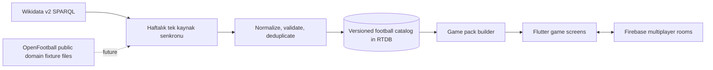

# AZ Oyun: Dinamik Futbol Oyunları — Proje Taslağı

**Durum:** Teknik keşif ve MVP kapsamı  
**Platform önceliği:** Önce mevcut Flutter uygulamasında Android; Flutter ortak koduyla web desteği ikinci aşama. Her yeni futbol modu ilk olarak Android oyun ekranı, telefon etkileşimi ve çevrimdışı veri davranışıyla tamamlanacak.
**Hedef:** Oyuncu ve kulüp geçmişini güncel veri kaynaklarından alan, aynı veri grafiğini birden fazla tek cihazlı ve online futbol oyununda kullanan bir oyun paketi.

## Ürün yönü

Referansların iyi çalışan ortak noktası, gerçek futbol bilgisini oyun kuralına çevirmeleri:

- `guess-the-football-player.com` lig/kulüp seçimi ve Beginner / Semi-Pro / World Class zorlukları olan süreli quizler ve skor tabloları sunuyor. Açık sayfada quizin kullandığı veri/API kaynağı belirtilmiyor. Bu nedenle bu sitenin kullandığı API hakkında doğrulanmış bir iddiamız yok.
- `playfootball.games` günlük ve çok oyunculu modları bir arada sunuyor. Özellikle Tiki-Taka-Toe, oyuncu bilgisini XOX kurallarına bağlıyor; aynı ekran, arkadaşla online ve rastgele rakip seçenekleri var. SuperDraft ise 11 kişilik kadroyu 3-4-3 gibi dizilişle kurdurup takım/ülke/lig ipuçlarını kullanıyor.

AZ Oyun bunlardan ilham alan, kendi görsel dili ve kuralları olan bir paket kurmalı. Oyunların temel farkı, aynı futbol verisi grafiğinden yararlanan birbirine bağlı modlar olması.

## Veri kararı: dinamik, istemciye API bağımlı değil

Oyuncu/kulüp listesini uygulama içine gömmek yerine, kaynaklardan düzenli güncellenen ve uygulamaya oyun paketleri olarak sunulan bir katalog kullanacağız.

1. **Ana açık veri:** Wikidata. Oyuncu `member of sports team (P54)` ilişkisi, tarih nitelikleri, spor uyruğu ve pozisyon kariyer rotası, kimya, grid ve isim/ipuçlu oyunları besler. Yapısal veriler CC0’dır. Sorguyu haftada bir backend’den alıp RTDB’de önbellekleyeceğiz; oyun turlarında WDQS'e gitmeyeceğiz. 2026-11-24 itibarıyla güncel v2 hostu `query-next.wikidata.org`; eski `query.wikidata.org` hostuna bağlı kalmayacağız. Wikidata herkese açık kullanımda yaklaşık 4 sorgu/saniye ve 240/dakika sınırı bildiriyor; haftalık tek sorgu bu bütçenin çok altında kalır.
2. **Fixture/sonuç desteği:** OpenFootball, lig/sezon JSON fikstür ve sonuçlarını public domain olarak sunuyor; en güncel `football.json` sezon kopyası günde bir güncelleniyor. İlk on modun kariyer kaynağı değil; ileride “maç günü / tarihli sonuç” trivia paketi için API anahtarsız statik veri sağlar. Kaynak güncelleme sıklığı upstream katkılara bağlı olduğundan gerçek zamanlı skor kaynağı olarak kullanılmayacak.
3. **Ücretsiz API ama ürün için uygun değil:** TheSportsDB kamuya açık v1 anahtarıyla 30 istek/dakika ve eski takım/onur endpoint'leri sunuyor. Ancak 17 Eylül 2026 tarihli koşulları, uygulama mağazasında yayımlanan uygulama için ücretli abone olmayı istiyor; görsellerin hakları da ayrıca kontrol edilmeli. Bu nedenle üretim ve mağaza uygulamasının ana sağlayıcısı olmayacak.
4. **Yalnız gerekli olduğunda:** football-data.org ücretsiz katmanda 12 yarışma, fixture, gecikmeli sonuç ve tablo verisi sunuyor; 10 çağrı/dakika. Ücretsiz katman oyuncu kariyer geçmişini sağlamadığı için ilk 10 oyunda gerekli değil; maç/turnuva veri kapsamı büyürse fixture çapraz kontrol kaynağı olabilir.

<<<<<<< Updated upstream
=======
### Free source/API decision

| Source | Free access and license/terms | Useful fields | AZOyun decision |
|---|---|---|---|
| **[Wikidata / WDQS](https://www.wikidata.org/wiki/Wikidata%3ALicensing)** | No API key; structured data is CC0. [Public SPARQL](https://www.wikidata.org/wiki/Wikidata%3ASPARQL_query_service/API) has service rate limits, so batch and cache requests. | Stable entity IDs, names/aliases, citizenship or sporting nationality, positions, and player-to-club membership statements (sometimes with start/end qualifiers). | Keep as the no-cost career-graph foundation. It is community-maintained and uneven: club membership does not guarantee a complete, correctly dated transfer timeline. Validate generated answers and exclude ambiguous/incomplete records. |
| **[OpenFootball `football.json`](https://github.com/openfootball/football.json)** | No API key; repository is marked [CC0/public domain](https://github.com/openfootball/football.json/blob/master/LICENSE.md). Latest season JSON is automatically regenerated daily, while upstream source datasets are not necessarily updated daily. | Match fixtures and results for covered leagues/seasons. | Use later for match/date trivia or fixture cross-checks. It has no player career, roster or transfer dataset, so it cannot power chemistry/career questions by itself. |
| **[API-Football / API-SPORTS](https://www.api-football.com/pricing)** | Free tier currently lists 100 requests/day and requires an API key. Free data is season-limited; coverage varies by competition. [Provider terms](https://www.api-football.com/terms) allow applications/fantasy projects but prohibit direct resale of its data. Logos/images may carry [third-party rights](https://www.api-football.com/documentation_v3) that the provider does not grant. | [Player profiles and season statistics, player-to-team seasons, transfers and trophies](https://www.api-football.com/documentation-v3), where the requested season/competition is covered. | Optional server-side enrichment only. Never ship its key in Flutter/web, never make a request per player turn, cache scheduled imports, and record provider/source IDs. Recheck terms and rights before distributing derived datasets or branded imagery. |
| **[football-data.org](https://www.football-data.org/pricing)** | Free tier: 12 competitions, delayed scores/schedules, fixtures/tables and 10 requests/minute. [Squads and deeper data](https://www.football-data.org/coverage) are in paid tiers. | Fixtures, results, standings; some person/squad resources exist but coverage/tier is limited. | Supplemental fixture/competition source only; not the primary historical player-career source. |

**What the current Wikidata catalogue can and cannot answer:** `functions/football-catalog.mjs` currently reads P54 sports-team membership, P27 citizenship, P1532 sporting nationality and P413 position, with optional P580/P582 start/end qualifiers. This supports player↔club/country/position membership games when the statement is present. The current query does not guarantee complete or chronological careers, transfer dates/fees, season rosters, appearances, match lineups, verified trophy wins or live statistics. Missing qualifiers are omitted, not inferred. The catalogue also does not currently merge API-Football or OpenFootball records.

**Decision:** retain Wikidata as the free default; use OpenFootball only for fixtures/results; integrate API-Football only as an opt-in scheduled backend enrichment after a key is configured and rights/coverage are checked. football-data.org remains an optional fixtures source. Games must keep working from the last validated cached catalogue when every external source is unavailable.

>>>>>>> Stashed changes
### On oyun ve ortak veri maliyeti

| # | Oyun | Temel veriler | Ücretsiz kaynak / servis çağrısı |
|---|---|---|---|
| 1 | Box2Box günlük 3×3 | Kulüp, ülke, oyuncu-kriter üyelikleri | Wikidata P54/P27/P1532; haftalık tek senkron |
| 2 | Futbol XOX / kategori 3×3 | Ülke×kulüp, lig×kupa gibi kesişimler | Aynı RTDB kataloğu; oda başına harici API çağrısı yok |
| 3 | Kariyer Rotası | Kronolojik kulüp geçişleri, başlangıç/bitiş yılları | Wikidata P54 nitelikleri |
| 4 | Gizli Futbolcu / ipucu oyunu | Kulüpler, pozisyon, spor uyruğu, dönem | P54/P413/P1532; fotoğraf kullanmadan |
| 5 | Futbol Wordle | Katalogdan seçilen ad/soyad, harf kıyaslama | Yerel oyun kuralı, harici API çağrısı yok |
| 6 | Kimya XI | Pozisyon, takım geçmişi, tarih kesişimi | P54/P413; mevcut chemistry kural motoru |
| 7 | SuperDraft XI | İpucu türü, pozisyonlu kadro, tekrar engeli | P54/P413/P27; aynı oyuncu kataloğu |
| 8 | Connections | 16 oyuncu, dört kategori ve beş hata hakkı | Aynı tag grafı; günlük seed backend’de |
| 9 | Oyuncu Bağlantı Yolu | İki oyuncu arasında kulüp bipartite grafı | P54 kariyer geçmişi |
| 10 | Futbol Bingo | Rastgele oyuncu ve geçerli kriter kutusu | Aynı tag grafı; günlük kart backend’de |

Bu on mod ilk sürümde ayrı ayrı ücretli API'ye bağlanmaz: tek normalize edilmiş katalog ve oyun paketleri paylaşılır. Bu veri kapsamı, maça ait tarihli ilk 11'i doğrulamaz. **Eksik 11** ayrı bir sonraki aşama olarak açık fixture/lineup kaynağı ve lisans ölçümü ister; 10 mod hedefinin yerine sessizce eklenmeyecek.

Cloud Functions scheduled function Blaze planı gerektirir. Mevcut oda süpürücüsü ile birlikte tek günlük futbol yayın işi kullanıyoruz; Google Cloud Scheduler ilk üç job’u billing account başına ücretsiz sayıyor ve sonrası $0.10/job/31 gün. Functions çağrıları ve RTDB trafiği de ilgili aylık ücretsiz kotalar içinde kalırsa ek ücret çıkmaz; bunun proje kullanımına göre ölçülmesi gerekir.

Kaynaklar: [Wikidata SPARQL v2 API ve rate limit](https://www.wikidata.org/wiki/Wikidata:SPARQL_query_service/API), [Wikidata CC0 / erişim rehberi](https://www.wikidata.org/wiki/Help:Data_access), [P54 kariyer modeli örneği](https://footyguess.com/data), [TheSportsDB güncel ücretsiz API ve limitleri](https://www.thesportsdb.com/API.php), [TheSportsDB oyuncu geçmişi endpoint'leri](https://api.thesportsdb.com/docs/api), [TheSportsDB kullanım ve görsel koşulları](https://www.thesportsdb.com/docs_terms_of_use.php), [OpenFootball public-domain fixture JSON](https://github.com/openfootball/football.json), [football-data.org ücretsiz plan](https://www.football-data.org/pricing) ve [coverage](https://www.football-data.org/coverage), [Firebase scheduled functions](https://firebase.google.com/docs/functions/schedule-functions), [Cloud Scheduler pricing](https://cloud.google.com/scheduler/pricing).

### Dinamik veri akışı

- Firebase Functions haftalık Wikidata senkronu ve günlük grid üretimini tek scheduler job içinde çalıştırır; User-Agent, 50 saniye WDQS timeout ve 60 saniye client timeout kullanır. WDQS hiçbir oyun turunda sorgulanmaz. Yenileme başarısızsa önceki geçerli katalog korunur.
- Normalize edilmiş kayıtlarda kararlı kaynak kimliği, adlar, pozisyon, ülke, kulüp bağlantısı, tarih aralığı, kaynak, kaynak güncelleme zamanı ve veri güven seviyesi bulunur.
- Her veri yayını `datasetVersion`, `generatedAt`, `sourceUpdatedAt` ve doğrulama özeti taşır. Yeni veri hatalıysa son geçerli sürüm yayında kalır.
- Yalnız kaynakta doğrulanabilen ilişkiler oyunda kesin cevap olarak kullanılır. Eksik tarih, belirsiz isim eşleşmesi veya doğrulanmamış kupa bilgisi soru üretiminden çıkarılır.
- Kullanıcıya ait her zaman canlı/gerçek skor veya oyuncu istatistiği vaadi vermiyoruz; ücretsiz/açık kaynakta güvenilir şekilde bulunan kariyer ilişkileriyle başlıyoruz.

## Oyun paketi

| Oyun | İlk sürüm kuralı | Tekrar kullanılabilir veri |
|---|---|---|
| **Kariyer Rotası** | Bir oyuncunun kulüpleri, ligleri ve dönemlerinden futbolcuyu tahmin et. 3 zorluk, sınırlı ipucu, süre ve puan. | oyuncu → kulüp → dönem |
| **Kimya XI** | 4-3-3/3-4-3 kadro kur. Sağ panel takım başına ortak oyuncu sayısını ve toplam bağlantı puanını gösterir. | Oyuncuların ortak kulüp tarihleri, pozisyonlar |
| **Futbol XOX / 4×4** | Satır/sütun kategorilerinin kesişimine uygun oyuncu adı gir. Yanlış cevap hücreyi harcatır; kategori doğruluğu kaynak ilişkilerinden kontrol edilir. | oyuncu → kulüp/ülke/lig/turnuva başarıları |
| **Eksik 11** | Tarihli maçın ilk 11’inden oyuncuları bul; önce veri kapsamı yeterli lig/sezonlarla sınırla. | maç kadrosu ve oyuncu ID eşleşmesi |
| **Ortak Soyunma Odası** | Verilen iki oyuncu veya iki kulüp arasındaki en kısa takım/oyuncu bağlantı yolunu bul. | oyuncu-kulüp zaman çizelgesi grafı |

### Geniş oyun kataloğu

Kullanıcının gönderdiği Box2Box görseli, ilk oynanabilir dilim için referans alındı: 3×3 kategori matrisi, isimle arama, hücre başına birden çok oyuncu, toplam oyuncu/kutu göstergesi ve süre. Kaynak oyunun UI varlıklarını/kodunu kopyalamadan AZ Oyun tasarımıyla uyguluyoruz. Araştırmada görülen diğer mekanikleri şu ürün ailelerine ayırıyoruz:

| Aile | AZ Oyun modu fikirleri | Veri ve oynanış çekirdeği |
|---|---|---|
| Kesişim tahtaları | Box2Box, Futbol XOX, 4×4 Tiki-Taka, ülke×kupa grid | Kriter tanımları + oyuncu üyelikleri; günlük seed, tekrar/çalma kuralları değiştirilebilir |
| Kadro ve kimya | Kimya XI, SuperDraft, 3-4-3 draft, aynı kulüpte oynama zincirleri | Pozisyonlu oyuncu grafı, ortak takım yılları, ülke/lig; sağ panelde kulüp/ülke bağlantı sayacı |
| Kariyer ve ipucu | Kariyer Rotası, oyuncu Wordle, bulanık fotoğraf yerine lisanslı/isim ipucu modu, kulüp tahmin | Tarih sıralı takım geçişleri, isim normalizasyonu, ipuçları, doğrulanmış cevap kimliği |
| Hafıza ve liste | Eksik 11, klasik maç ilk 11'i, top-10 listesi, istatistik kartı kıyaslama | Maç/sezon roster kapsamı ve istatistik kaynağı; veri yoksa o maç/paket oyuna alınmaz |
| Grup ve rekabet | Oyuncu kategorileri Bingo, arkadaş odasında draft, 3 kişilik sıra turu, Rondo imposter | Aynı dataset sürümü ve cevap paketi; oda kodu, sıra/puan kuralları, sunucu doğrulaması |
| Günlük mini oyunlar | Bağlantı grupları, nadir cevap/anket, lig sözlüğü, oyuncudan oyuncuya yol bulma | Seed'li günlük paket, grup/anket kaynağı veya graf arama, sonuç paylaşım özeti |

İlk geliştirme sırası: **Box2Box** (mevcut ilk ekran), **Kimya XI** (kullanıcının özgün ana fikri), **Kariyer Rotası**, **kategori XOX**, ardından veri kapsamı ölçülen Eksik 11 ve grup/online odaları. Site üzerinde listelenen GoalLess, Mine Games, TenaBall, Football Bingo, Missing XI, Gegenpressure, Fan Favourites, Futbol List a, Who Are Ya?, The Heatmap, Box2Box, Career Path Challenge, Contextinho, Football Connections, Football Wordle, Who Ate All the Pies, Possession Play, Rondo Ringer ve SuperDraft; bu tabloya oyun mekaniği aileleri olarak dahil edildi. Bunlar kopyalanacak birebir ekranlar değil, ayrı kurallarla yeniden tasarlanacak fikirler.

İlk dağıtılabilir kapsam Kariyer Rotası, Kimya XI ve 3×3 Futbol XOX olacak. 4×4, turnuva/ödül kategorileri ve maç kadrosu oyunları, veri kapsama ölçümleri yeterli olduğunda eklenecek.

## Teknik yerleşim

### Uygulama

- Mevcut [football_quiz_screen.dart](../lib/features/football/football_quiz_screen.dart) içindeki sabit `_players` / `_clubs` veri bankası yerine repository üzerinden yüklenen oyun oturumu kullanılmalı. Şu anki Wikidata isteği yalnız açıklamaları çekiyor; oyuncu/kulüp soruları yine sabit listelerden geliyor.
- `lib/features/football/data/`: DTO/model, `FootballCatalogRepository`, Functions istemcisi ve cache fallback.
- `lib/features/football/games/`: katalogdan bağımsız saf oyun motorları (career path, chemistry scoring, grid validator) ve ekranlar.
- `FootballGamesHub`: futbol oyunlarını tek bölümde keşfetme, tek cihaz/online/günlük mod seçimi.
- Oyuncu görselleri için varsayılan olarak metin/harf avatarı. Lisansı doğrulanmış görsel kaynağı ayrı varlık sağlayıcısı olur.

### Sunucu ve Firebase

- Mevcut Firebase Functions codebase'i `functions/` içinde oda temizlik zamanlayıcısı var; `family-server/` ayrı HTTP API olarak deploy ediliyor. Oyun verisi senkronizasyonu ve oyun paketi üretimi ayrı bir Functions modülü olmalı; aile API'sine karıştırılmamalı.
- RTDB'de sürümlü okuma kataloğu ve oyun/oda state'i ayrılmalı. Oda state'ine kaynak cevap anahtarı düz metin olarak konmamalı.
- Arkadaşla online modda oyuncu cevapları sunucu tarafında doğrulanır veya cevap anahtarı yalnız doğrulama fonksiyonuna kapalı tutulur. Aynı cihaz modunda yerel oyun motoru yeterli.
- Yeni online oyun kimlikleri `kOnlineGameIds`, başlık/localization haritaları, oda davet yönlendirmesi ve RTDB kurallarında birlikte güncellenir. İki oyuncu + 3 kişilik draft/turnuva seçenekleri oda şablonu üzerinden tanımlanır.

## Teslim aşamaları

### A — Veri kaynağı ve sözleşme

- Wikidata P54, kulüp alias/ID, başlangıç-bitiş tarihleri ve doğrulama bayrakları için normalize şemayı çıkar.
- Küçük kapsamlı veri sorgusunu, sınırları gözeterek backend’den çalıştır; cevap, lisans ve attribution bilgilerini sakla.
- En az birkaç yüz aktif ve emekli futbolcu içeren ilk katalog için coverage raporu oluştur. Metrikler: oyuncu sayısı, kariyer kulübü sayısı, tarihli ilişki oranı, duplicate/ambiguous sayısı.

### B — Oynanabilir dinamik MVP

- Kariyer Rotası ekranı katalogdan yeni soru üretir; bağlantı kesilince son başarılı paket üzerinden oynar.
- Kimya XI ve Futbol XOX kuralları saf Dart motorlarında çalışır ve aynı datasetVersion ile sonuç verir.
- Ana ekrandaki Futbol Atölyesi yeni Futbol Oyunları merkezine bağlanır; eski statik quiz kaldırılır veya geçiş süresince yönlendirilir.

### C — Arkadaşla online oyun

- Firebase oda/lobi akışına Kariyer Düellosu ve Futbol XOX eklenir; oda koduyla katılım, host/yeni oyun, ayrılma ve tekrar eşitleme kuralları uygulanır.
- Tüm oyuncular aynı `packId`/`datasetVersion` üzerinde oynar. Sunucu doğrulaması olmadan cevaplar ortak RTDB state’ine yazılmaz.

### D — Kapsamı büyütme

- Zamanlı maç kadroları, kupalar ve lig filtreleri eklenmeden önce kaynak başına coverage ve yanlış pozitif oranı ölçülür.
- TheSportsDB entegrasyonu mağaza sürümü için yapılmaz; sağlayıcının mevcut koşulları ücretli abonelik şartı koyuyor. Ücretsiz listelenen uygulama erişimi açıkça izin veren yeni bir lisans/provider bulunursa karar tekrar değerlendirilir.
- Günlük seed, geçmiş maç koleksiyonları, 4×4 grid, lig/sezon temaları ve sezonluk leaderboard eklenir.

## MVP kabul ölçütleri

- Oyuncu/kulüp cevapları uygulama kaynak kodunda sabit listelerden gelmiyor; aynı veri kataloğu birden fazla modu besliyor.
- Kaynak güncellemesi kullanıcıya yeni oyun paketleri olarak ulaşabiliyor ve son iyi veri sürümüne geri düşebiliyor.
- Kariyer bağlantısı ve kategori kesişimi kaynak kimlikleri ile doğrulanıyor; ad benzerliği tek başına yeterli değil.
- Oda oyuncuları aynı soru ve sürümde kalıyor; diğer oyuncular cevap anahtarını istemci state’inden okuyamıyor.
- Görsel/logolar lisans kaydı olmadan yayınlanmıyor; oyunlar logosuz oynanabilir kalıyor.

## Keşif notları ve sınırlamalar

- İlk referansın başlangıç akışında zorluk seçimi (Beginner, Semi-Pro, World Class) ve ligi/kulübü hedefleyen quiz yapısı görüldü. Açık yüzey/API kaynağı açıklanmıyor.
- Playfootball.games ana sayfasında günlük GoalLess, Mine Games, TenaBall ve Bingo yanında çok oyunculu Possession Play, Rondo Ringer, Tiki-Taka-Toe ve Bingo listeleniyor. Tiki-Taka-Toe aynı ekran, online arkadaş, rastgele rakip ve tek oyunculu günlük varyantı sunuyor. Kurallar 3×3 kategori kesişimi ve isteğe bağlı hücre çalma içeriyor. SuperDraft, 3-4-3 dizilişiyle 11 pozisyon ve takım/ülke/lig eşleşme ipuçları kullanıyor.
- Bu turda REA kontrollü Edge replay ile Box2Box DOM'u ve `App.t8orrqkw.js` bundle'ı yakalandı. Sayfa Astro 5.18.2; oyun adasında `gameId=eu1`, `storagePrefix=b2b_eu1_`, `startDate=2023-05-16` var. Bundle, `https://cdn.playfootball.games/api/box2box/{gameId}/{difficulty}/players.json`, `gameData.json` ve `daily/{gameNumber}.json` dosyalarını `Promise.all` ile paralel GET yapıyor. REA bu üç endpoint'ten HTTP 200 ve JSON gövdeleri okudu. Easy oyuncu dosyasında 11.918 kayıt; oyuncu ad alanı (`n`), kategori ID listesi (`v`), bazı adaşlarda pozisyon (`p`) ve doğum tarihi (`a`) var. GameData'de 91 kategori, kategori ID/ad/tür/itibar alanları ve zorlukta 10–120 olası cevap ile 50–200 itibar sınırları var. Günlük paket altı kriter listesi taşıyor: ilk üçü sütun, son üçü satır; `Se` fonksiyonu dokuz hücreyi bu kombinasyonlardan üretiyor. Oyuncu, kesişimin iki kriterindeki tüm ID'leri `v` içinde taşıyorsa kabul ediliyor; aynı oyuncu bütün tahtada ikinci kez kullanılamıyor. Günlük numara başlangıç tarihinden gün farkı, zorluk `b2b_difficulty` yerel ayarından türetiliyor. 3 dakikalık sayaç, oyun ilerlemesi ve istatistikler `localStorage`'da. Yani görülen Box2Box'ta oyuncu listesi anlık üçüncü taraf futbol API'sinden sorgulanmıyor; CDN JSON veri paketleri olarak sunuluyor.
- Opera GX ile yapılan ilk yakalamadaki `gxcorner.games` istekleri tarayıcı entegrasyonuydu; Edge replay'de bunlar yoktu. Oyuna ait doğrulanmış yüklemeler `cdn.playfootball.games/_astro/*` JS bundle'ları ve yukarıdaki `/api/box2box/...` JSON yollarıdır. Google Analytics, reklam ve font istekleri oyun verisi kaynağı değildir.
- Bu gözlem Box2Box'a özgüdür; `guess-the-football-player.com` için veri/API sağlayıcısı açık sayfada belirtilmiyor. İki referansın kullandığı tek bir API varmış gibi varsaymıyoruz.
- Futbol11 için bu turda REA kontrollü Edge ile eski `futbol-11.com/futbol-grid` ve taşınmış `futbol11.com` incelendi. Eski sayfa Vue/webpack, yeni site Nuxt; `/futbol11-grid` başlatılınca 3×3 kategoriler ve takım görselleri geliyor. Oyun başlatma penceresinde ayrı futbolcu JSON/API çağrısı gözlenmedi. Yeni Grid oyuncu kaydı `Ccdc3iYt.js` istemci paketinde yaklaşık 324 KB olarak bulundu; kayıtlar `id`, `firstName`, `lastName`, `countryID`, `image`, `grid` gibi alanlar içeriyor. Kural kodu `4QqT9oiF.js` içinde: kolay mod kulüp/ülke, normal kulüp, zor ülke varyantlarını, legend ayrıca kulüp varyantlarını kullanıyor; satır ve sütun gruplarının `footballers` ID kesişimi hücrenin cevaplarını veriyor, tahtada kullanılan oyuncu tekrar adaylardan çıkarılıyor. Günlük cevaplar ve istatistikler `f11-grid`, `f11-grid-daily`, `f11-grid-timer` localStorage anahtarlarında; süre seçenekleri yok/90/60/40 saniye. Bu, harici API bulunmadığına dair tüm olası backend yollarını kanıtlamaz; sadece bu kontrollü akışta görünür istek olmadığını gösterir.
- Futbol11'in başka akışlarında Connections 16 oyuncuyu ortak dört kategoriye grupluyor; 5 hata hakkı ve kolay/normal/zor modları var. Top10 verilen başlığa göre 10 oyuncu bulduruyor ve başlangıçta uyruk ipucu gösteriyor. Crossword ülke bayrağı/kulüp/pozisyon ipuçlarını kullanıyor. SquadSlice geçmiş sezon takımını kadrodaki ülke dağılımının pasta grafiğinden 3 tahminde bulduruyor; her yanlış cevap/atla hamlesi grafiğin daha fazlasını açıyor. Statdle geçmiş sezon oyuncusunu maç/goal/assist/pozisyon/ülke/yaş/değer/kulüp ipuçlarından bulduruyor. Bu sayfalarda başlatma anında uygulama veri endpoint'i gözlenmedi; oturum anahtarları oyun türüne göre değişiyor. Bu oyunların tüm veri tabanı lisans/kaynak yapısı bu yakalamayla belirlenmedi.
- Futbol11 REA oturum kanıtları: Grid ekranı `ev_4291b1e9e01dfd90cf5819b0e723c209f331b7f07f0bbb711a40fc3ba49f6c83`; oyun başlatma ağı/depolaması `ev_638ce9c7db1e40b8fd10d797c184f7e3f59db6df1c34cd80baa0ba1be4d8b424`; Grid bundle mantığı `ev_20da8633954a78c9951bde84a21459b3370dd98f7e550180b0eff2765d4f8d98`; Connections başlatma `ev_624f67ffffd1cede667e80b98df96eb6d0b5ee8f377039f4d4d9c0943f79956c`; SquadSlice `ev_23ff2c7ee63d944ebaef1fb85dd543412569ba1cd9f875c98632c9602689589a`; Statdle `ev_8d144ee91ee6fa99970373bcdd2d016802a7ab7e9ddbbfa8e3b03cfb59b6ff90`; Top10 `ev_ee78bc6cc273f9b4cb91f5a86981c006a6e3a5eac992716141d45aa05ef58445`; Crossword `ev_ab20d0b283c273ebb386b87ad96cebeacb712c04453fd523ccef725491ed3ea9`.
- Android hedefi Flutter uygulamasının mevcut ekranlarıdır; bu web sitelerinin Vue/Nuxt kodu veya görsel seti taşınmıyor. Görünen oyun kuralları ortak, sürümlü Wikidata kariyer grafiği üzerinden yeniden kuruluyor. Android RTDB persistence açık tutulup `footballCatalog/current` diske senkronlanacak; Grid süresiz/90/60/40 seçeneği, global tekrar engeli ve Connections 4×4 modu eklendi. Connections günlük 16 oyuncu ve dört disjoint cevap grubunu backend günlük paketinde üretir; Android aynı paketi ve aynı ID tabanlı board sırasını kullanır.
- `guess-the-football-player.com` için de REA Edge replay yapıldı: quiz sayfası 200 döndü; jQuery 3.4.1, jQuery UI ve Bootstrap istemcileri ile sitenin `js/ajax.js` ve `assets/js/main.min.js` dosyaları yüklendi. `ajax.js` formdaki `action`/`data-action` yoluna `request_type=ajax` ve cache kırıcı zaman alanı ekleyip jQuery AJAX gönderiyor. Ana script süreyi istemcide sayıyor, Enter ile quiz formunu gönderiyor ve çözüm açıklamasında başka bir formu AJAX ile yolluyor. İlk sayfa açılışında oyuncu veri JSON'u/API çağrısı görünmedi; backend yolunu/oyuncu kaynağını belirlemek için cevap gönderme gibi etkileşimli adım gerekir. O nedenle bu kaynağın oyuncu verisini de kendi backend'inden alıyor olduğu kanıtlanmadı.
- İlk kod dilimi: `functions/football-catalog.mjs` Wikidata v2 hostundan P54 kulüp kariyeri, P27 vatandaşlık, P1532 spor uyruğu ve P413 pozisyon alıyor. Tek günlük Cloud Function pazarları haftalık katalog yeniliyor, her gün 3×3 Box2Box ve 4×4 Connections paketleri üretiyor. Sorgunun `SELECT` alanına P1532 spor uyruğu dahil edildi. `football_grid_screen.dart` Box2Box'ı; `football_chemistry_screen.dart` pozisyonlu 4-3-3 Kimya XI'ı; `football_career_path_screen.dart` tarihli kulüp geçmişinden Kariyer Rotası'nı aynı RTDB kataloğundan yüklüyor. Veri paketi Firebase'e henüz yayınlanmadığı için bu ekranlar boş paket durumu gösterebilir.
- Altı dinamik Android futbol ekranı kodda başladı: Kimya XI, Kariyer Rotası, Futbol Wordle, Oyuncu Bağlantı Yolu, Box2Box ve 4×4 Connections. Bu, tabloda tanımlanan on oyun hedefinin tamamlandığı anlamına gelmiyor. Kalan modüller aynı katalog/kural tabanı üzerinde aşamalı eklenecek.
- Box2Box'ın yakalanan akışına göre sonraki teknik işler: katalog senkronizasyonu ve sürüm yayını, grid paket üreticisi, arama/typeahead deneyimi, sunucu tarafı rekabetçi doğrulama. Bu REA çıktısı hedef ürünün kaynak kodu değildir; yalnızca dışarıdan gözlenen davranış ve paket sözleşmesini tarif eder.
- Ruflo’da altı uzman rolü oluşturuldu; `agent_execute` çağrıları bu ortamda sağlayıcı anahtarı olmadığı (`ANTHROPIC_API_KEY` / `OPENROUTER_API_KEY` / `OLLAMA_API_KEY`) için çalıştırılamadı. Araştırma ve kod tabanı incelemesi ana ajan tarafından tamamlandı; 6-agent çıktısı alınmış gibi gösterilmiyor.
